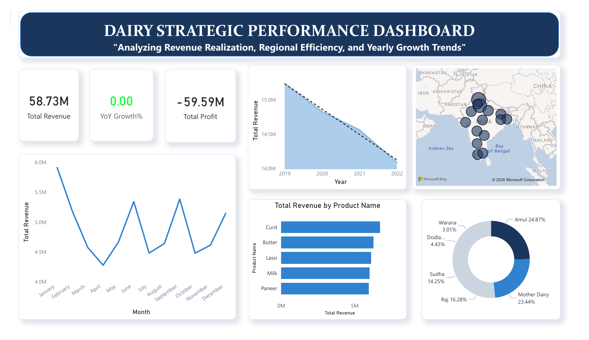
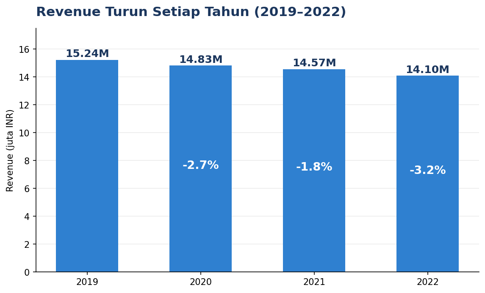
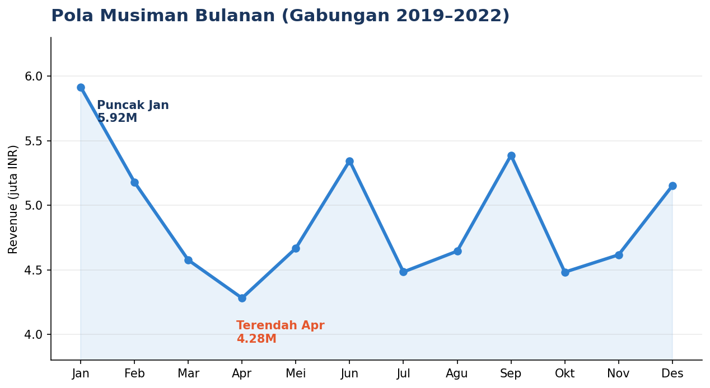
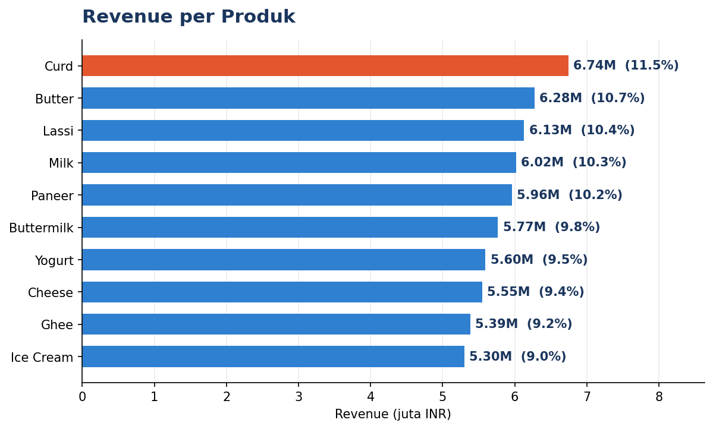
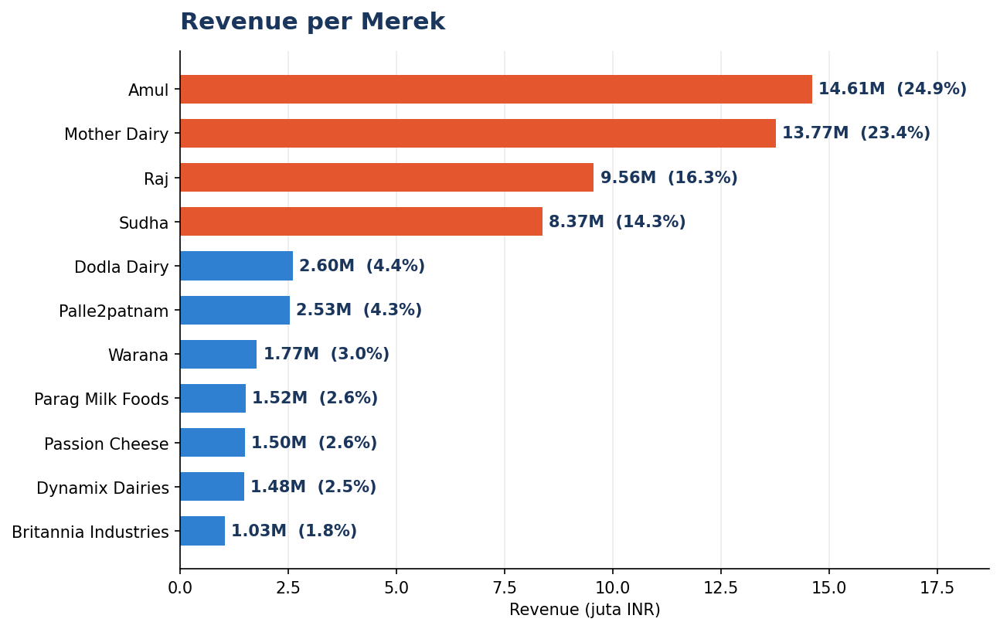
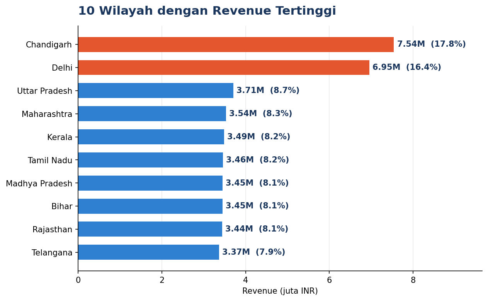
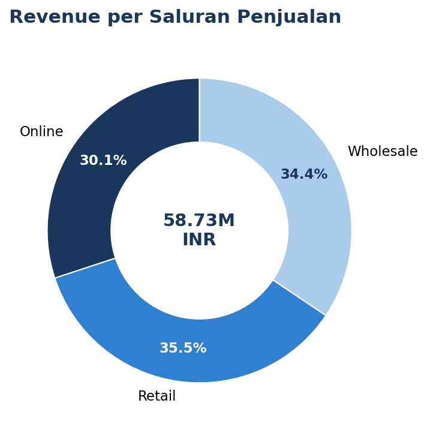

<div align="center">

# 🥛 Dairy Strategic Performance Dashboard
### *Analyzing Revenue Realization, Regional Efficiency, and Yearly Growth Trends*


</div>

---

## 📌 Ringkasan

Proyek ini adalah dashboard **Power BI** untuk menganalisis kinerja industri susu (*dairy*) di India: dari produksi dan stok hingga penjualan, merek, saluran distribusi, dan wilayah.

Dashboard menjawab tiga hal utama sesuai subjudulnya:
- **Revenue realization:** berapa pendapatan yang benar-benar terealisasi?
- **Regional efficiency:** wilayah mana yang paling berkontribusi?
- **Yearly growth trends:** ke mana arah pertumbuhan dari tahun ke tahun?



---

## 🗂️ Dataset

Dataset diambil dari Kaggle: **[Dairy Goods Sales Dataset](https://www.kaggle.com/datasets/suraj520/dairy-goods-sales-dataset)** oleh *suraj520*.

Dataset ini adalah kumpulan data komprehensif yang mencatat **operasional, produksi, dan penjualan** dalam industri susu. Berdasarkan analisis awal, dataset mencakup **4.325 entri** yang memberikan gambaran mendalam tentang ekosistem peternakan dan distribusi produk susu di berbagai wilayah di India.

| Atribut | Keterangan |
|---|---|
| Jumlah baris | 4.325 |
| Jumlah kolom | 23 |
| Periode | 1 Januari 2019 – 28 Desember 2022 |
| Wilayah | 15 negara bagian / wilayah di India |
| Produk | 10 (Milk, Curd, Butter, Lassi, Paneer, Buttermilk, Yogurt, Cheese, Ghee, Ice Cream) |
| Merek | 11 (Amul, Mother Dairy, Raj, Sudha, dan lainnya) |
| Saluran penjualan | Retail, Wholesale, Online |
| Mata uang | INR (Rupee India) |

### Kelompok Kolom

| Kelompok | Kolom |
|---|---|
| 🌾 **Peternakan** | `Location`, `Total Land Area (acres)`, `Number of Cows`, `Farm Size` |
| 🏭 **Produksi** | `Product ID`, `Product Name`, `Brand`, `Quantity (liters/kg)`, `Price per Unit`, `Total Value`, `Production Date` |
| ❄️ **Penyimpanan** | `Shelf Life (days)`, `Storage Condition`, `Expiration Date` |
| 💰 **Penjualan** | `Date`, `Quantity Sold (liters/kg)`, `Price per Unit (sold)`, `Approx. Total Revenue(INR)`, `Customer Location`, `Sales Channel` |
| 📦 **Inventori** | `Quantity in Stock (liters/kg)`, `Minimum Stock Threshold (liters/kg)`, `Reorder Quantity (liters/kg)` |

---

## 📈 Hasil Utama

| Indikator | Nilai |
|---|---:|
| **Total Revenue** | **58,73 juta INR** |
| Rata-rata revenue per tahun | ± 14,7 juta INR |
| Tingkat penjualan terhadap produksi | ± 49,6% |

### 1. Revenue Menurun Setiap Tahun



Revenue turun dari **15,24 juta (2019)** menjadi **14,10 juta (2022)**, atau sekitar **−7,5%** dalam empat tahun. Jumlah transaksi juga turun, dari 1.109 (2019) menjadi 1.035 (2022), sehingga penurunan revenue sebagian besar sejalan dengan berkurangnya volume transaksi.

### 2. Pola Musiman yang Jelas



Revenue tertinggi terjadi pada **Januari (5,92 juta)** dan terendah pada **April (4,28 juta)**. Ada puncak kecil lain pada Juni dan September.

### 3. Penjualan Produk Relatif Merata



**Curd** memimpin (11,5%), diikuti Butter dan Lassi. Selisih antar produk tipis, dari 11,5% (Curd) hingga 9,0% (Ice Cream), sehingga tidak ada produk yang terlalu dominan.

### 4. Empat Merek Menguasai Hampir 79% Revenue



**Amul (24,9%), Mother Dairy (23,4%), Raj (16,3%), dan Sudha (14,3%)** menyumbang sekitar **78,8%** dari total revenue. Tujuh merek lainnya berbagi sisa sekitar 21%.

### 5. Penjualan Terpusat di Chandigarh dan Delhi



Chandigarh (12,8%) dan Delhi (11,8%) menyumbang sekitar **24,7%** revenue, hampir dua kali lipat wilayah lain yang masing-masing di kisaran 5–6%. Pola serupa terlihat pada `Customer Location`.

### 6. Tiga Saluran Penjualan Seimbang



Retail (35,5%), Wholesale (34,4%), dan Online (30,1%) berimbang. Kanal online sudah menyumbang hampir sepertiga revenue.

### 💡 Rekomendasi

- **Selidiki penyebab tren turun**, misalnya harga, jumlah pelanggan, atau persaingan, dan susun strategi untuk membalikkannya.
- **Manfaatkan musim ramai Januari** dan siapkan promosi di bulan lemah seperti April.
- **Kurangi ketergantungan pada empat merek utama** dan Chandigarh-Delhi dengan memperluas distribusi ke wilayah lain.
- **Pertajam efisiensi stok.** Hanya sekitar separuh kuantitas produksi yang terjual, dan 918 dari 4.325 baris (21%) memiliki stok di bawah ambang minimum.

> ⚠️ Rekomendasi bersifat hipotesis dari data historis 2019–2022 dan perlu divalidasi.

---

## ⚠️ Catatan Penting tentang Dashboard

Dua angka pada dashboard perlu dibaca dengan hati-hati:

### 🔴 Total Profit = −59,59 juta tidak mencerminkan kerugian nyata
Angka ini sama dengan **Total Revenue (58,73 juta) dikurangi jumlah `Total Value` (118,32 juta)**. Masalahnya, `Total Value` adalah nilai **seluruh kuantitas yang diproduksi**, sedangkan revenue hanya berasal dari **sekitar separuh yang terjual**. Dua hal yang tidak sebanding sedang dikurangkan.

Dataset ini juga **tidak memiliki kolom biaya (COGS)**, sehingga laba sebenarnya tidak dapat dihitung. Jika `Price per Unit` dipakai sebagai harga pokok untuk unit yang terjual, margin hampir nol (kurang dari 0,01%), karena harga jual dan harga unit nyaris sama. Karena itu sebaiknya ukuran ini diganti, misalnya menjadi **Sell-Through Rate** (kuantitas terjual ÷ kuantitas produksi) atau **Revenue per Unit**.

### 🟡 YoY Growth% = 0,00
Kartu ini menampilkan 0,00, padahal revenue sebenarnya turun setiap tahun (−2,7%, −1,8%, −3,2%). Kemungkinan penyebabnya adalah measure DAX yang dibandingkan tanpa tabel kalender atau tanpa filter tahun. Contoh perbaikan:

```dax
Revenue PY = CALCULATE ( [Total Revenue], SAMEPERIODLASTYEAR ( 'Calendar'[Date] ) )
YoY Growth % = DIVIDE ( [Total Revenue] - [Revenue PY], [Revenue PY] )
```

---

## 🔍 Catatan Kualitas Data

- Tidak ada nilai kosong atau baris duplikat.
- Pada **2.564 baris (59%)**, `Expiration Date` lebih awal daripada `Date` transaksi. Ini mengindikasikan dataset bersifat **sintetis** dan kolom tanggal sebaiknya tidak dipakai untuk menilai kedaluwarsa produk.
- `Price per Unit (sold)` rata-rata hanya berbeda sekitar 0,07% dari `Price per Unit`, sehingga analisis margin harga kurang bermakna.

---

## 📊 Komponen Dashboard

| Visual | Fungsi |
|---|---|
| Kartu **Total Revenue**, **YoY Growth%**, **Total Profit** | Ringkasan KPI |
| Line chart **Revenue per Bulan** | Pola musiman |
| Area chart **Revenue per Tahun** | Tren pertumbuhan |
| Peta India | Sebaran revenue antar wilayah |
| Bar chart **Revenue by Product Name** | Perbandingan produk |
| Donut chart **Revenue per Merek** | Pangsa merek |

---

## 🧰 Teknologi

- **Microsoft Power BI Desktop** untuk pemodelan dan visualisasi
- **DAX** untuk measure dan kalkulasi KPI
- **CSV** sebagai sumber data (dari Kaggle)

---

## 📁 Struktur Repositori

```
Dairy-Performance-Dashboard/
├── assets/                                # Gambar untuk README
│   ├── dashboard-preview.png
│   ├── chart-yearly.png
│   ├── chart-monthly.png
│   ├── chart-product.png
│   ├── chart-brand.png
│   ├── chart-location.png
│   └── chart-channel.png
├── dairy_dataset.csv                      # Dataset (Kaggle)
├── Dairy performance Dashboard.pbix       # File dashboard Power BI
├── Dairy Performance Dashboard.pdf        # Hasil dashboard (PDF)
└── README.md
```

---

## 🚀 Cara Menjalankan

1. **Clone repositori**
   ```bash
   git clone https://github.com/ashafamultazam/Dairy-Performance-Dashboard.git
   cd Dairy-Performance-Dashboard
   ```
2. **Install Power BI Desktop** (gratis, hanya untuk Windows).
3. **Buka** `Dairy performance Dashboard.pbix`.
4. Jika sumber data tidak ditemukan, arahkan ke `dairy_dataset.csv` lewat **Transform data → Data source settings**.

Tanpa Power BI, lihat hasilnya di `Dairy Performance Dashboard.pdf`.

---

## 🧾 Keterbatasan

- Dataset berupa **data latihan (sintetis)** dari Kaggle, bukan data operasional riil.
- **Tidak ada data biaya**, sehingga profitabilitas tidak dapat dinilai.
- Grafik di README dibuat dari `dairy_dataset.csv` dengan Python (matplotlib). Tampilan Power BI aslinya bisa berbeda.
- Hubungan antar variabel adalah **korelasi**, bukan bukti sebab-akibat.

---

## 👤 Penulis

**Asha Fa Multazam** — [GitHub](https://github.com/ashafamultazam)

## 🙏 Ucapan Terima Kasih

- **suraj520** atas dataset di Kaggle
- Komunitas **Power BI** atas dokumentasi dan referensinya

---

<div align="center">

⭐ Jika proyek ini bermanfaat, beri bintang pada repositori ini.

</div>
